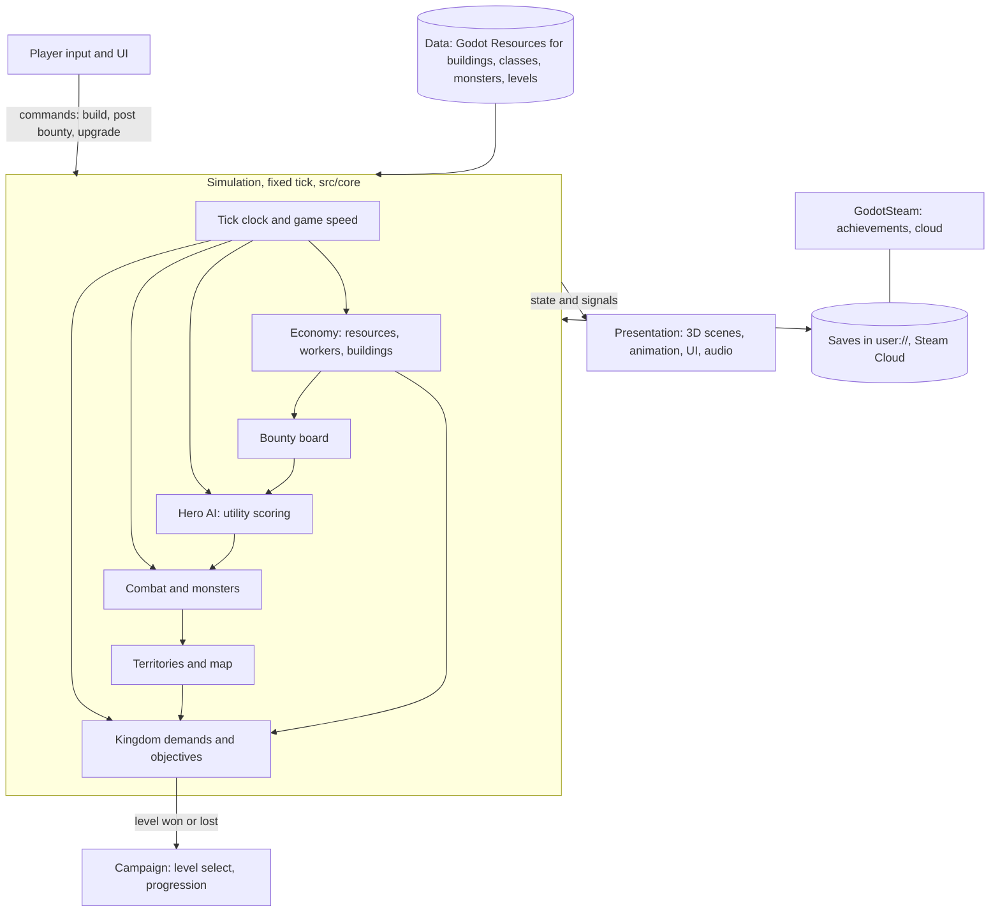

# Architecture

## Current state (v0.1.0)

A single boot scene and one helper class. Everything below "Planned" is the intended structure and is not built yet.

- `src/main/main.tscn` + `main.gd`: boot scene.
- `src/core/game_version.gd`: `GameVersion`, reads the version from project settings.
- `tests/`: GdUnit4 suites mirroring `src/`.
- `.github/workflows/ci.yml`: headless tests. `.github/workflows/tag-release.yml` + `scripts/tag_release.sh`: release tags.

## Planned structure

The guiding rule: the simulation knows nothing about rendering. It advances on a fixed tick and exposes state and signals; the presentation layer (3D scenes, UI, audio) reads that state and sends player commands back.

## Changes

- v0.1.0: initial structure.
