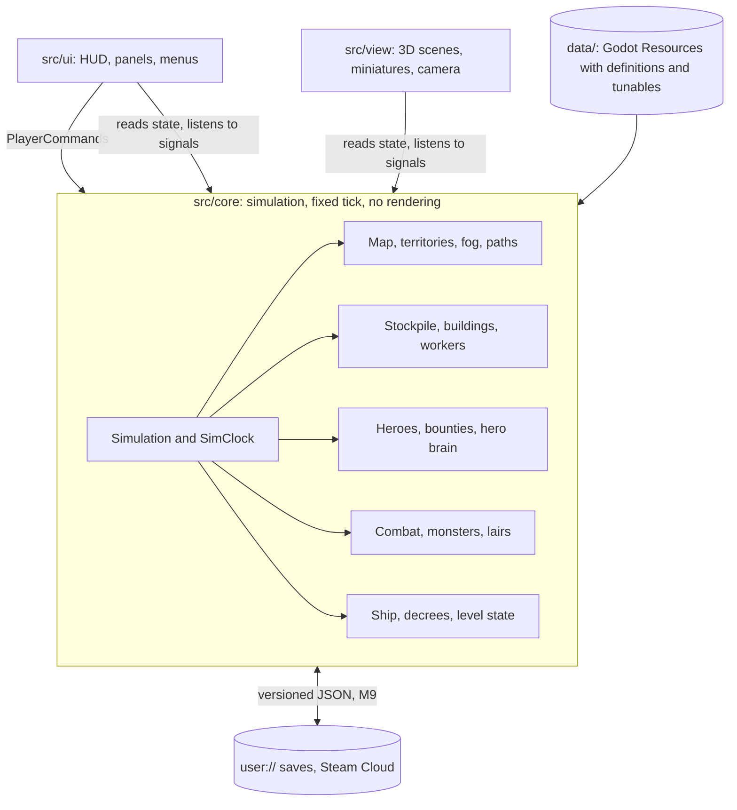

# Architecture

Where code goes and how the parts talk to each other. Read this before adding a file. Rules have IDs (A1, A2, ...) so pull requests and reviews can cite them.

## Current state (v0.1.4)

Only the setup exists: a placeholder boot scene (`src/main`), `GameVersion` (`src/core/game_version.gd`), its tests, CI and release tagging. Everything under "Target structure" is the plan that PLAN.md tasks build towards; a directory appears when its first task ships.

## Layers



## Rules

| ID | Rule | Why |
|---|---|---|
| A1 | `src/core` contains no rendering, no scene-tree access and no input handling. Core classes extend `RefCounted` or `Resource`, never `Node`. They must not reference `Node3D`, `Control`, `Input`, `get_tree()` or anything under `src/view` or `src/ui`. | The simulation runs headless in tests and stays cheap to save. |
| A2 | Core advances only through `Simulation.tick()`. No core code reads wall-clock time or frame delta. | Determinism and game-speed control. |
| A3 | All randomness in core comes from the seeded `RandomNumberGenerator` owned by `Simulation`. Never call the global `randf()`, `randi()` or `randomize()`. | The same seed and commands must reproduce the same game. |
| A4 | Systems tick in one fixed, documented order (listed below). Add a new system to that list in the same pull request. | Order-dependent bugs are otherwise invisible. |
| A5 | The player changes the simulation only through `PlayerCommands`. Interface code never mutates core objects directly. Every command returns a result that says whether it was accepted and, if not, why. | Every player action is testable, and later recordable. |
| A6 | View and interface read core state and listen to core signals. Core never calls into view or interface. | One-way dependency. |
| A7 | Every tunable number and every definition (building, unit, class, resource, level) lives in a Resource under `data/`. No gameplay literals in code. | Balance changes without code changes (GDD section 6). |
| A8 | Entities are referred to by integer id across systems and in saves, not by object reference where the reference would outlive a tick. | Save/load and safe removal of dead entities. |
| A9 | Positions in core are tile coordinates (`Vector2i` for tiles, `Vector2` for units between tiles). The view converts to world space: tile (x, y) maps to world (x, 0, y), scaled by `tile_size`. | One conversion point. |
| A10 | GDScript is statically typed throughout: typed variables, parameters and return values. Each script that others use declares a `class_name`. | Errors at parse time; readable code. |
| A11 | Tests mirror the source tree: `src/core/x/y.gd` is tested by `tests/core/x/y_test.gd`. Scenario tests that span systems live in `tests/scenarios/`. | Findability. |
| A12 | Third-party code lives only under `addons/`. Do not edit it. | Clean upgrades. |

## Target structure

```
src/
  core/                 simulation (rule A1)
    sim/                Simulation, SimClock, SimSystem
    config/             scripts for config resources
    map/                GameMap, Territory, PathService, FogSystem, ResourceNode
    level/              LevelDefinition
    economy/            Stockpile, ResourceDefinition, Cost
    buildings/          BuildingDefinition, BuildingSystem
    workers/            Worker, JobSystem
    units/              Unit, MovementSystem
    combat/             CombatSystem
    monsters/           Monster, Lair
    heroes/             Hero, HeroClassDefinition, HeroRoster, HeroBrain, hero_states/
    bounties/           Bounty, BountyBoard, BountyScorer
    ship/               ShipSystem
    territory/          claiming
    kingdom/            Decree, DecreeSystem, LevelState
    commands/           PlayerCommands
  view/                 3D presentation: island/, camera/, units/, buildings/, bounties/, ship/
  ui/                   2D interface: hud/, bounties/, heroes/, kingdom/, theme/
  main/                 boot scene, wiring core to view and ui
  debug/                demo scenes, not shipped
data/                   config/, levels/, resources/, buildings/, units/, heroes/
assets/models/          generated .glb files (never edit by hand; rule in tools/art)
tools/art/              Python model generator
tools/levels/           level generation helpers
tests/                  mirrors src/ (rule A11); scenarios/; art/
scripts/                repository automation
addons/                 third-party (rule A12)
```

## Tick order

One simulation tick runs these systems in this order. Systems not yet built are skipped.

1. `ShipSystem`
2. `JobSystem` (worker decisions)
3. `HeroBrain` (hero decisions)
4. Monster and lair decisions
5. `MovementSystem`
6. `CombatSystem`
7. `BuildingSystem` (construction progress, destruction)
8. `FogSystem`
9. `BountyBoard` (completion checks, payment)
10. Territory and `DecreeSystem`, then `LevelState`

## Naming and style

- Files and folders: `snake_case`. Classes: `PascalCase`. Constants and enum values: `UPPER_SNAKE_CASE`. Signals: past tense (`bounty_completed`).
- Scenes sit next to their script with the same base name.
- Data resource ids are lowercase strings (`"warrior"`, `"guard_tower"`) and match the file name.
- Comments explain why, and cite GDD rule IDs where a rule is implemented, for example `# BNTY-6: split equally among participants`.
- Tests are named `test_<behaviour>` and assert one behaviour each.

## Testing approach

| Kind | Where | What |
|---|---|---|
| Unit | `tests/core/**` | One core class, hand-computed expectations |
| Scenario | `tests/scenarios/` | Several systems driven for N ticks with a fixed seed through `PlayerCommands` |
| Smoke | `tests/view/**`, `tests/ui/**` | A scene loads and runs a few frames headless without errors |
| Asset | `tests/art/` | Generated models import and match scale rules |

Run everything with the command in CLAUDE.md. Rendering quality cannot be tested headless; state that in the pull request and describe the manual check.

## Changes

- v0.1.4: target structure, layer rules A1 to A12 and tick order written down ahead of implementation.
- v0.1.0: initial structure.
